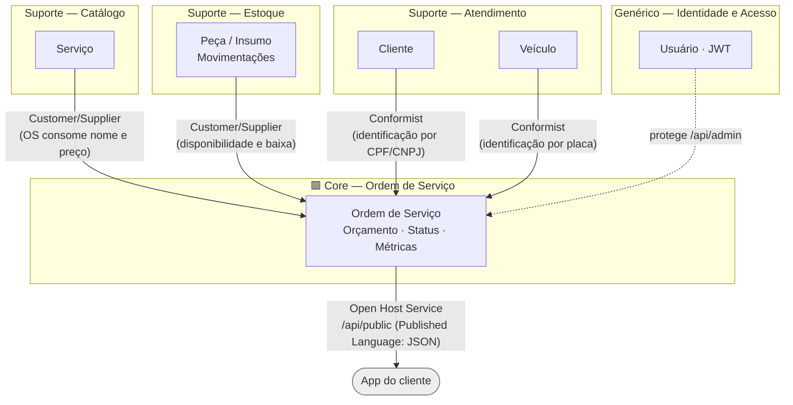
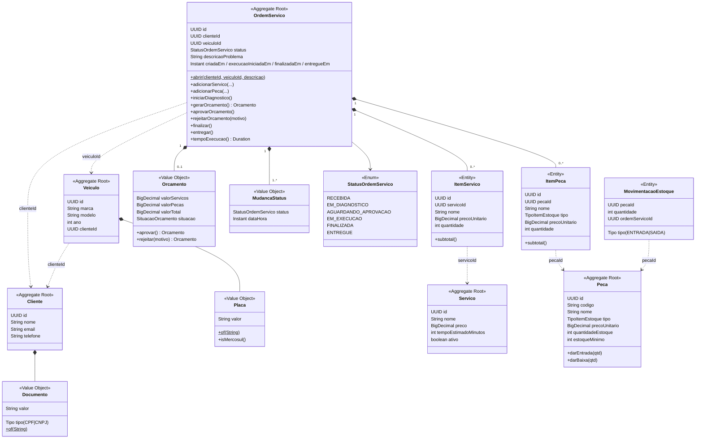
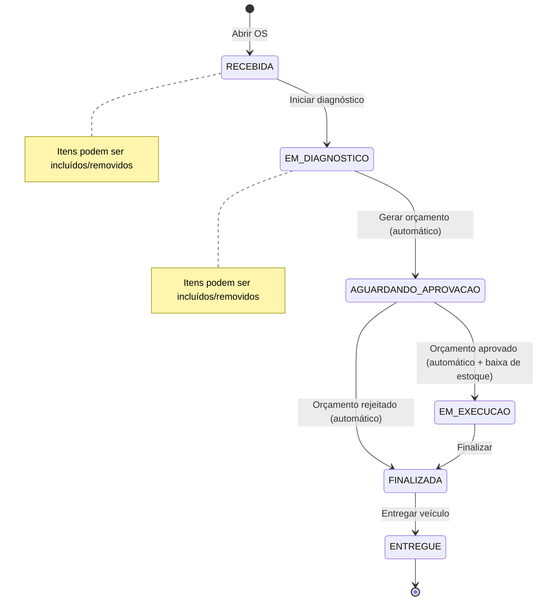
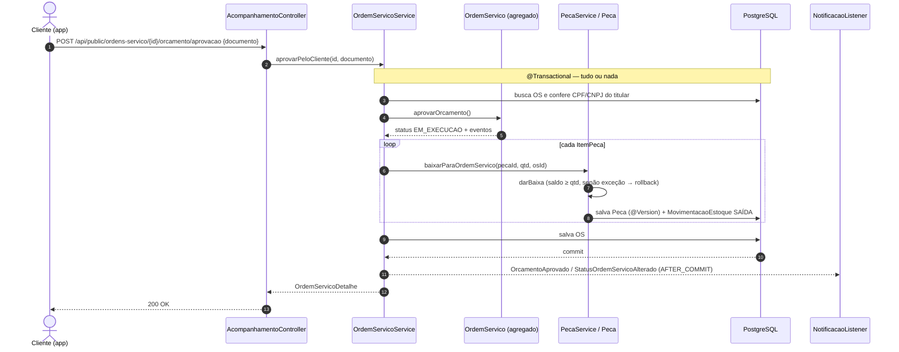
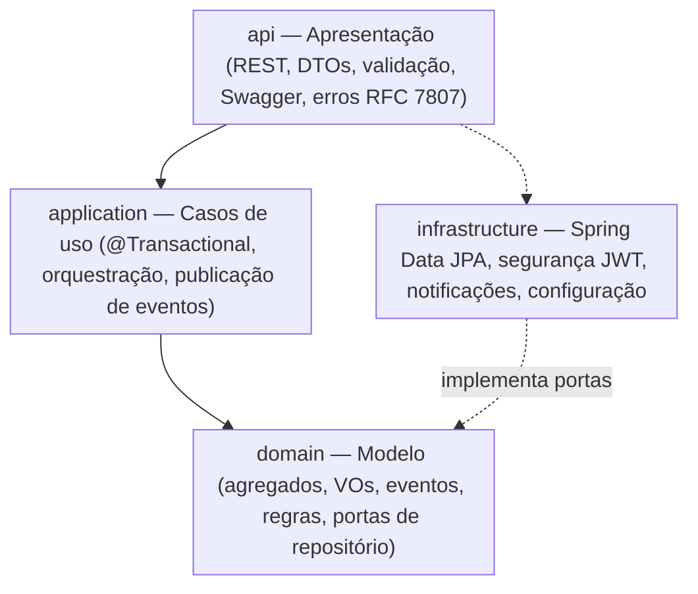

# Diagramas DDD

## 1. Subdomínios e Bounded Contexts

| Bounded Context | Tipo de subdomínio | Responsabilidade | Pacotes |
|---|---|---|---|
| **Ordem de Serviço** | Núcleo (*core*) | Ciclo de vida da OS, orçamento, aprovação, status, métricas | `domain.ordemservico`, `application.ordemservico` |
| **Estoque** | Suporte | Peças/insumos, saldo, movimentações, alerta de mínimo | `domain.estoque`, `application.estoque` |
| **Catálogo de Serviços** | Suporte | Serviços oferecidos, preço e tempo estimado | `domain.catalogo`, `application.catalogo` |
| **Clientes e Veículos (Atendimento)** | Suporte | Cadastro e identificação por CPF/CNPJ e placa | `domain.cliente`, `domain.veiculo` |
| **Identidade e Acesso** | Genérico | Usuários internos, autenticação JWT | `infrastructure.security` |

> Por ser um MVP monolítico, os contextos convivem no mesmo deployable e banco, separados por pacotes.
> As fronteiras são respeitadas referenciando outros agregados **apenas por identidade (UUID)** e
> copiando os dados necessários (nome e preço congelados nos itens da OS).

## 2. Mapa de Contextos

## 3. Agregados, entidades e objetos de valor

Linhas tracejadas = referência **por identidade** entre agregados (sem navegação de objeto).

## 4. Máquina de estados da OS

Qualquer outra transição lança `TransicaoStatusInvalidaException` (HTTP 409).

## 5. Sequência — aprovação do orçamento pelo cliente

## 6. Arquitetura em camadas

