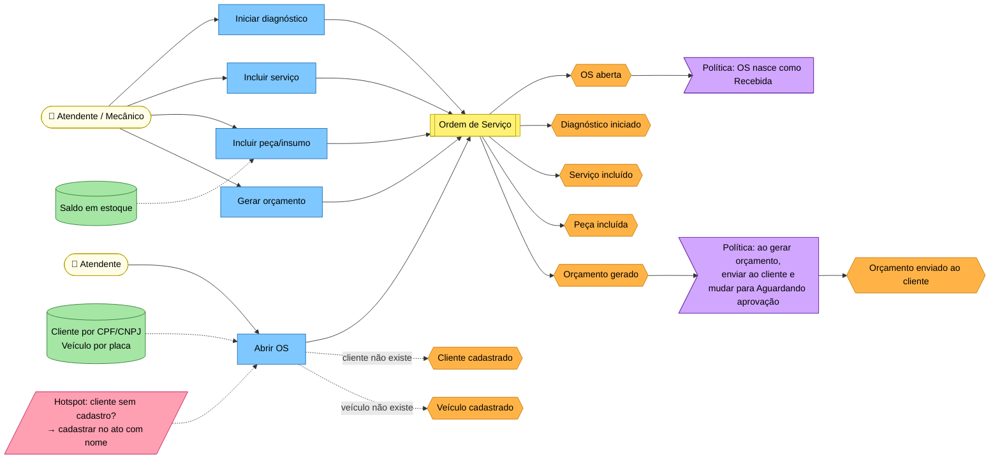
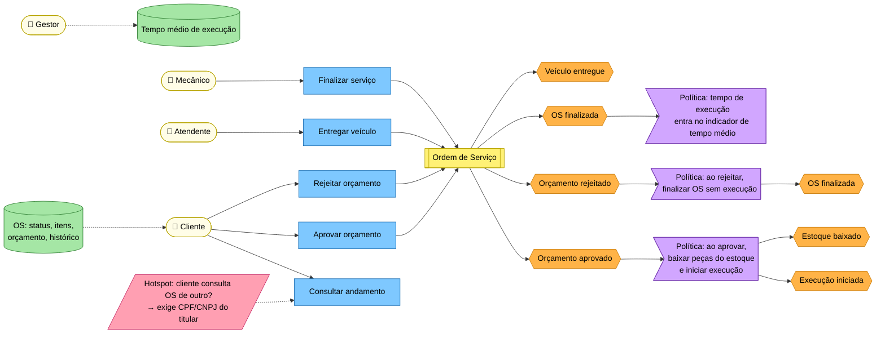
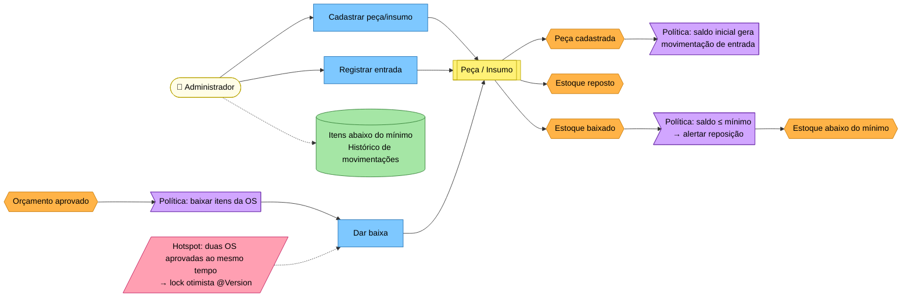

# Event Storming

Sessão de *Big Picture* refinada até o nível de *Design Level* para os três fluxos exigidos.
Legenda das cores (padrão Event Storming), usada também no quadro do Miro e em [`event-storming.pdf`](event-storming.pdf):

| Cor | Elemento |
|---|---|
| 🟧 Laranja | Evento de domínio (passado) |
| 🟦 Azul | Comando |
| 🟨 Amarelo pequeno | Ator |
| 🟨 Amarelo grande | Agregado |
| 🟪 Lilás | Política / regra ("sempre que… então…") |
| 🟩 Verde | Modelo de leitura (o que o ator consulta para decidir) |
| 🟥 Rosa | Ponto de atenção / *hotspot* |

> Cada evento abaixo existe no código (`domain/**/evento`) ou corresponde a uma mudança de estado explícita no agregado.

---

## 1. Criação da Ordem de Serviço

| Ator | Comando | Agregado | Evento | Política / regra |
|---|---|---|---|---|
| Atendente | Abrir OS | Ordem de Serviço | `OrdemServicoAberta` | Cliente identificado por CPF/CNPJ válido; veículo por placa válida; veículo deve pertencer ao cliente |
| Atendente | (implícito) Cadastrar cliente | Cliente | Cliente cadastrado | Só cadastra se o nome for informado; documento único |
| Atendente | (implícito) Cadastrar veículo | Veículo | Veículo cadastrado | Exige marca, modelo e ano (1900 … ano atual + 1); placa única |
| Mecânico | Iniciar diagnóstico | Ordem de Serviço | `StatusOrdemServicoAlterado` (→ Em diagnóstico) | Só a partir de Recebida |
| Mecânico | Incluir serviço | Ordem de Serviço | Serviço incluído | Serviço deve estar ativo; preço é congelado |
| Mecânico | Incluir peça/insumo | Ordem de Serviço | Peça incluída | Saldo deve cobrir a quantidade total na OS; preço congelado |
| Mecânico | Gerar orçamento | Ordem de Serviço | `OrcamentoGerado` | Precisa de ao menos 1 item; status muda automaticamente para Aguardando aprovação; cliente é notificado |

---

## 2. Acompanhamento da Ordem de Serviço

| Ator | Comando | Evento | Política / regra |
|---|---|---|---|
| Cliente | Consultar andamento | — (leitura) | Exige número da OS + CPF/CNPJ do titular; documento divergente responde 404 |
| Cliente / Atendente | Aprovar orçamento | `OrcamentoAprovado`, `StatusOrdemServicoAlterado` (→ Em execução) | Só com orçamento Pendente; baixa de estoque na mesma transação — sem saldo, nada é confirmado |
| Cliente / Atendente | Rejeitar orçamento | `OrcamentoRejeitado`, `StatusOrdemServicoAlterado` (→ Finalizada) | Estoque não é alterado; OS não entra no indicador de tempo |
| Mecânico | Finalizar serviço | `StatusOrdemServicoAlterado` (→ Finalizada) | Só a partir de Em execução |
| Atendente | Entregar veículo | `StatusOrdemServicoAlterado` (→ Entregue) | Só a partir de Finalizada; estado final |
| Gestor | Consultar tempo médio | — (leitura) | Considera OS com execução iniciada e finalizada |

---

## 3. Gestão de peças e insumos

| Ator | Comando | Evento | Política / regra |
|---|---|---|---|
| Administrador | Cadastrar peça/insumo | Peça cadastrada | Código único; preço ≥ 0; saldo inicial ≥ 0 gera movimentação de entrada |
| Administrador | Registrar entrada | Estoque reposto | Quantidade > 0; gera `MovimentacaoEstoque` ENTRADA |
| Sistema (política) | Dar baixa | Estoque baixado | Disparado pela aprovação do orçamento; saldo nunca negativo (`EstoqueInsuficienteException`); gera movimentação SAÍDA vinculada à OS |
| Sistema (política) | — | `EstoqueAbaixoDoMinimo` | Após a baixa, se saldo ≤ mínimo, alerta de reposição |

---

## Consolidação

### Eventos de domínio
`OrdemServicoAberta` · `StatusOrdemServicoAlterado` · `OrcamentoGerado` · `OrcamentoAprovado` · `OrcamentoRejeitado` · `EstoqueAbaixoDoMinimo`
(+ eventos de estado sem classe própria: Cliente cadastrado, Veículo cadastrado, Serviço/Peça incluída, Estoque reposto, Estoque baixado — registrados como mudança no agregado e/ou `MovimentacaoEstoque`).

### Comandos
Abrir OS · Iniciar diagnóstico · Incluir/Remover serviço · Incluir/Remover peça · Gerar orçamento · Aprovar orçamento · Rejeitar orçamento · Finalizar OS · Entregar veículo · Cadastrar/Atualizar/Remover cliente, veículo, serviço, peça · Registrar entrada de estoque · Autenticar usuário.

### Políticas
1. OS sempre nasce **Recebida**.
2. Itens só podem mudar em **Recebida** ou **Em diagnóstico**.
3. Gerar orçamento ⇒ **Aguardando aprovação** + notificação do cliente.
4. Aprovar ⇒ baixa de estoque **atômica** + **Em execução**.
5. Rejeitar ⇒ **Finalizada** sem execução e sem baixa.
6. Saldo ≤ mínimo após baixa ⇒ alerta de reposição.
7. Cliente só acessa a OS com o próprio CPF/CNPJ.
8. Fila de atendimento ordenada por prioridade de status e antiguidade.

### Atores
Atendente · Mecânico · Administrador/Gestor · Cliente · Sistema (políticas automáticas).

### Agregados
Ordem de Serviço · Cliente · Veículo · Serviço · Peça/Insumo.
